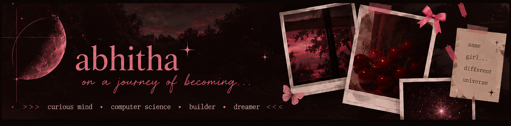
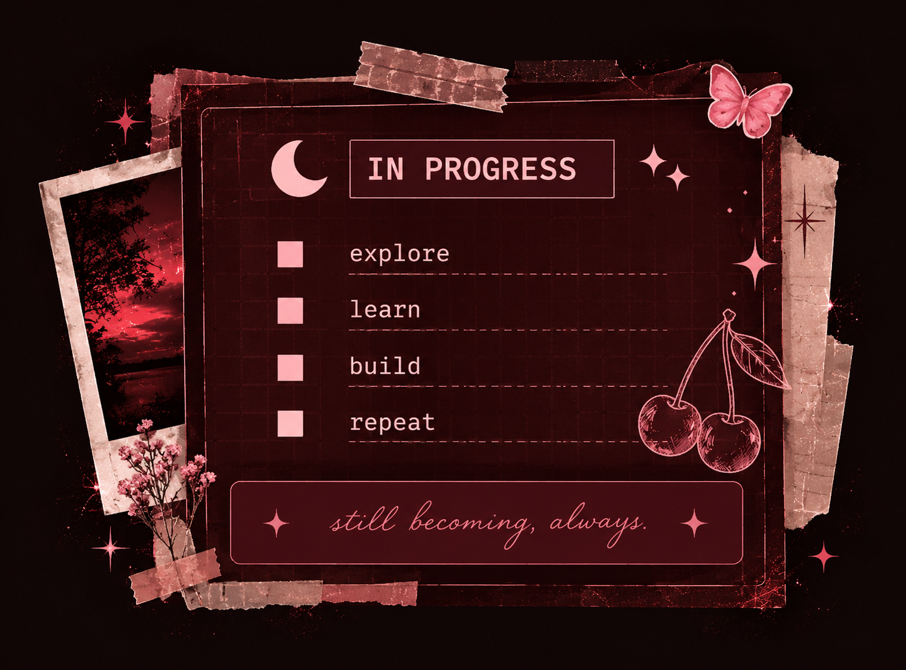
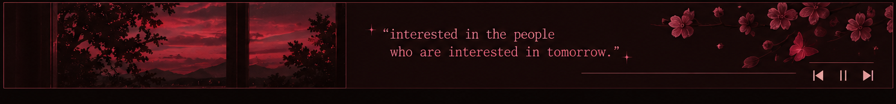

 

`CURIOUS MIND` ✦ `COMPUTER SCIENCE` ✦ `BUILDER` ✦ `DREAMER`

---

<table>
<tr>
<td width="65%" valign="middle">

01 / THE PERSON BEHIND THE CODE

<h2>curious by default.</h2>

I like understanding how things work, turning ideas into something real, and exploring the space between technology and creativity.

<pre>
const abhitha = {
  studying: "Computer Science",
  currently: ["learning", "exploring", "building"],
  interests: ["AI/ML", "web", "space", "design"],
  motto: "curiosity over perfection"
};
</pre>

</td>
<td width="35%" align="center" valign="middle">

</td>
</tr>
</table>

---

### ✳ `/toolkit`

---

<table>
<tr>
<td width="50%" valign="top">

<h3>🥀 <code>// currently exploring</code></h3>

✦ Core computer science  
✦ AI/ML and computer vision  
✦ Web development  
✦ Creative technology  
✦ New ideas and tools  

</td>
<td width="50%" valign="top">

<h3>☾ <code>// beyond the screen</code></h3>

<table>
<tr><td>♫</td><td>Music</td></tr>
<tr><td>☾</td><td>Space & the night sky</td></tr>
<tr><td>✧</td><td>Sci-fi & fantasy</td></tr>
<tr><td>🍒</td><td>Rainy days</td></tr>
<tr><td>∞</td><td>Learning for fun</td></tr>
</table>

</td>
</tr>
</table>

---

---

<table>
<tr>
<td width="55%" valign="top">

<h3>✧ <code>/find me around</code></h3>

</td>
<td width="45%" valign="top">

<h3>◌ <code>/status</code></h3>

<pre>
student   [ ongoing ]
explorer  [ always ]
builder   [ in progress ]
version   [ evolving ]
</pre>

</td>
</tr>
</table>

---

🍒 **made of curiosity & a little chaos.**

✦ still becoming. ✦

